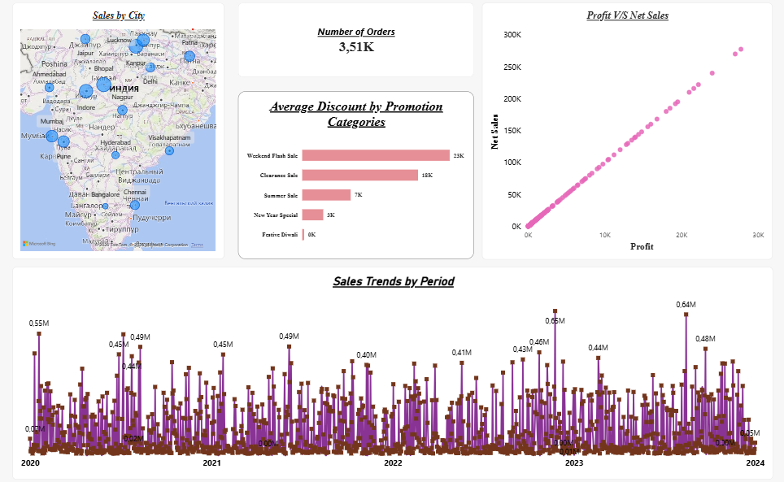
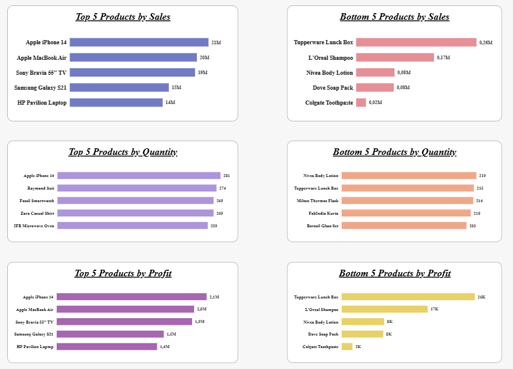
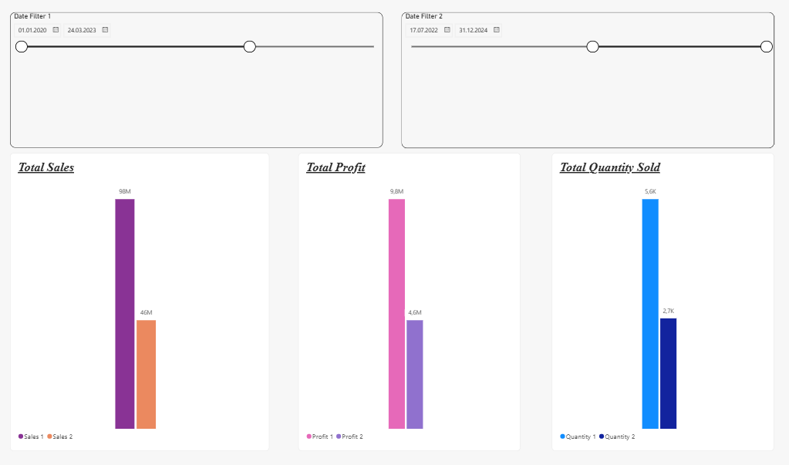
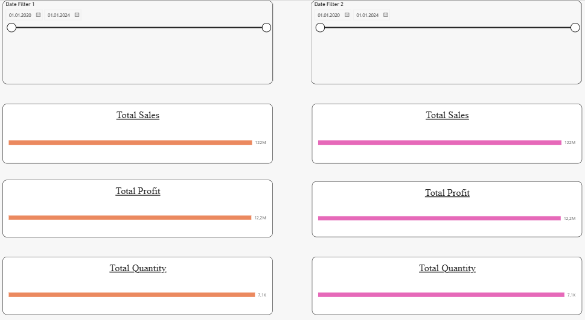
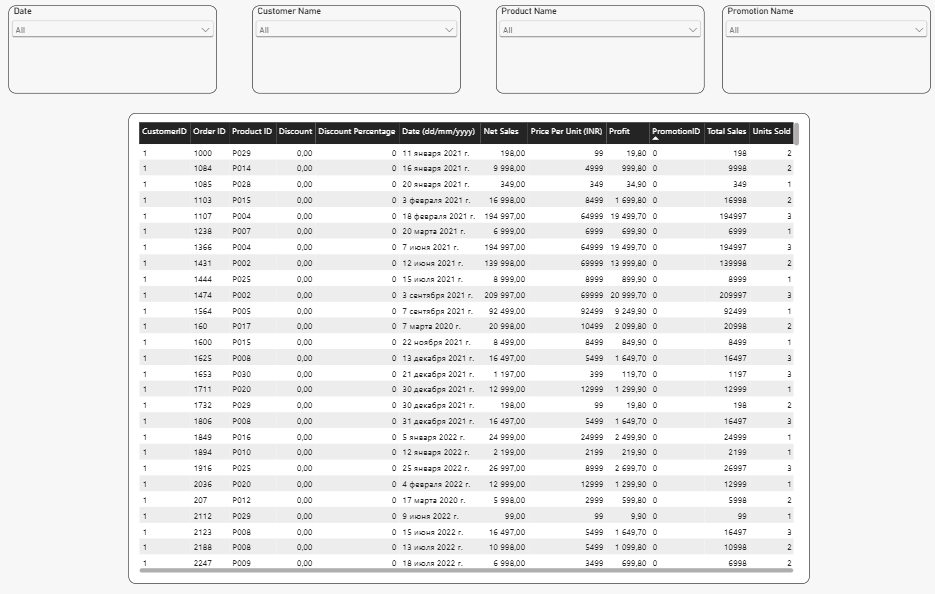

# Sales Data Analysis — Power BI

An interactive 5-page Power BI report analysing sales performance, profitability, product rankings, and promotion impact. Built on a dimensional **Star Schema** with custom **DAX** measures.

## Project Overview

**Goal:** Identify top/bottom products, track sales trends over time, and evaluate how discounts affect profit.

**Tools:** Power BI Desktop, Power Query, DAX, Tableau.

## Data Model (Star Schema)

| Table | Type | Description |
|---|---|---|
| `Fact Table` | Fact | Orders: Order ID, Units Sold, Net Sales, Profit, Discount, Price Per Unit |
| `Dim Customers` | Dimension | Customer name, city |
| `Dim Product` | Dimension | Product ID, product name |
| `Dim Promotion` | Dimension | Promotion ID, promotion name |
| `Data Table 1/2` | Date | Date tables for time-based analysis |
| `Measure Table` | Measures | Centralised DAX measures |

Relationships: one-to-many and similar from each dimension to `Fact Table` via primary/foreign keys (CustomerID, Product ID, PromotionID, Date).

## Data Preparation (Power Query)

- Data profiling and cleansing: [e.g. removed duplicates, fixed data types, handled nulls]
- ETL transformations: [e.g. split raw table into fact and dimensions, created date columns]

## DAX Measures

```dax
Total Profit = SUM('Fact Table'[Profit])
```

- `Sum of Net Sales` — total net sales
- `Total Profit` — total profit
- `Quantity Sold` — total units sold
- `Profit Margin` — [formula]
- `Average Discount` — [formula]
- `Sales PoP %` — period-over-period comparison [formula]

## Report Pages

### 1. Overview
KPI card (orders), sales trend over time, sales by city (map), profit vs. net sales (scatter), average discount by promotion category.


### 2. Top/Bottom 5 Analysis
Top and Bottom 5 products by sales, quantity, and profit.


### 3. Comparison Sales / Profit / Quantity
Combo charts comparing total sales, profit, and quantity with date slicers.


### 4. Edit Interactions
Demonstrates custom visual interactions: selecting a visual filters or leaves unaffected the others.


### 5. Table Visual
Detailed order-level table with slicers by product, customer, promotion, and date.


## Key Insights

- [e.g. Product X generates the highest profit but not the highest sales]
- [e.g. Higher discounts in promotion Y correlate with lower profit]
- [e.g. Sales peak in month Z]

## How to Run

1. Download `Project_Sales_Data_Analysis.pbix`.
2. Open it in [Power BI Desktop](https://powerbi.microsoft.com/desktop/) (free, Windows).
3. Use the slicers and click on visuals to explore the data.

## Author

**Yuliia Cherhinets** — [LinkedIn](http://www.linkedin.com/in/yuliia-cherhinets-4a736a2a8) | [GitHub](https://github.com/raychiikk)
